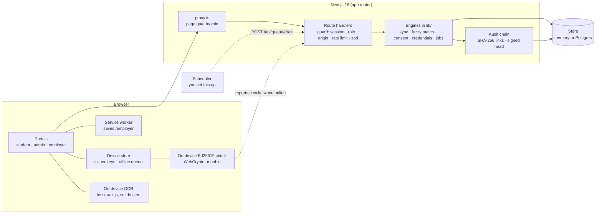

# APAAR Bridge

A privacy-first verification layer between college ERPs, AICTE, NAD/ABC, students and employers. A prototype for SIH 2026 (PS SIH26263).

- **Registrars** turn messy ERP marksheets (typed, pasted, or read from a photo) into clean NAD records, resolve name mismatches before the government check rejects them, and answer student disputes.
- **AICTE** sees compliance per programme, can drill from a college to a programme to individual (pseudonymous) students, sees flagged cases with the reasons behind them, and one tamper-evident audit log.
- **Students** get a digital twin (timeline, credit forecast, skill gaps) and a consent wallet where they choose who sees what, and for how long. The student portal works in English and Hindi.
- **Employers** verify a credential and get yes-or-no claims the student allowed, with every ID number redacted. Checks work with no network.

Everything here is **sample data**: the people, colleges and ID numbers are fictional.

## Run it

```bash
npm install
npm run dev          # http://localhost:3000
```

Open `/login` and pick a persona. No configuration is needed in development: it uses an in-memory store, a development pepper and an ephemeral signing key. A banner says so in a deployment that is missing real settings.

| Command | What it does |
|---|---|
| `npm run dev` | Development server |
| `npm run build` / `npm start` | Production build and server |
| `npm run typecheck` | TypeScript |
| `npm run lint` | ESLint (flat config, `eslint-config-next`) |
| `npm test` | Vitest: unit tests plus route-level security tests (213) |
| `npm run db:seed` | Writes the sample data into the database `DATABASE_URL` points at. Safe to run again. Refuses to run without `DATABASE_URL` |

`npm run dev` and `npm run build` first copy the OCR engine's files into `public/ocr/` (git-ignored), so marksheet reading never fetches anything from a third-party host.

## Who can do what

Sign in as one of ten demo personas. The server enforces the role on every route, from a signed cookie. The page gate (`proxy.ts`) is a convenience: a request that skips it still gets a 401 or 403.

| Role | Personas | Can |
|---|---|---|
| Student | Rahul K.V., Ananya Banerjee, Imran Q. (opted out), Priya L., Meera S. (age 16) | Own consent wallet, QR creation, disputes, opt-out. The four adults also have a digital twin. |
| Guardian | Sunita S. (Meera's mother) | Co-sign or withdraw consent for Meera. Nothing else. |
| Registrar | Registrar, Vindhya Institute | Marksheet sync (CSV or photo), match decisions, retry queue, dispute inbox, audit log, tokenization. |
| AICTE officer | AICTE officer | National compliance and drill-down, flagged cases, audit log, incident clocks. No college console. |
| Verifier | Acme Cloud HR, FinServe Bank HR | Verify credentials, ask students for consent, bulk API. Consent is per verifier. |

A person under 18 is determined from the date of birth on the student record. There is no switch a student can flip. The five students are built to show different cases: a solid record with one cleared backlog (Rahul), a strong record with no backlogs who appears in two colleges' lists (Ananya), an open failed course and a credit shortfall (Imran, who has also opted out), a large shortfall (Priya), and a minor with no academic record yet (Meera).

## Architecture



- **Store** (`lib/store`): one small document interface with two implementations. The Postgres one is a single `kv` table; its SQL is tested against real Postgres (PGlite) in `tests/store.test.ts`.
- **Audit chain** (`lib/audit.ts`): consent, match decisions, NAD syncs, grade changes, disputes and offline verifications share one log. Each entry hashes the one before it. The head is signed with the issuer's Ed25519 key, so cutting the log short or recomputing every hash is caught.
- **Matching** (`lib/fuzzyMatcher.ts`): two questions kept apart. *Same person?* (a confidence) and *Will the government check accept it as written?* (literal match). A name can be clearly the same person and still be rejected, so it becomes `AUTO_FIXABLE` with the exact correction. Matching only flags: a person confirms every decision, and it is audited.
- **Sync** (`lib/nadSyncEngine.ts`): never invents a grade, credit, course code or prior record. Rows it cannot grade are excluded and reported, and a sync that would leave rows out needs the registrar to confirm.
- **Credentials** (`lib/credentials.ts`, `lib/qrVerify.ts`): Ed25519-signed QR payloads with a key id. Offline verification runs in the browser against cached keys and cannot see revocation, and says so.
- **Marksheet OCR** (`components/admin/OcrScan.tsx`, `lib/ocrParse.ts`): tesseract.js runs in the registrar's browser, so the image never leaves the device. The parser is strict and reports every line it could not read, with a confidence. Nothing it reads is trusted: it fills the CSV box, the registrar must tick that they checked every value against the sheet, and the normal sync validation still runs.
- **Retry queue** (`lib/jobs.ts`): batches wait as jobs in the store, so they survive a refresh and are shared. Each attempt either succeeds or fails and retries after a longer wait (2 s doubling to 60 s), up to 5 attempts, then the job is dead-lettered for a person. A drain is one atomic store update, so a cron call and a click cannot both take the same job. **The call to NAD itself is still simulated** (a "NAD reachable" switch lets you cause an outage); there is no real NAD endpoint to call.

## Settings

Copy `.env.example`. In production the first three are required: the app answers `503` naming what is missing (see `/api/health`) instead of falling back to a weak default.

| Variable | Needed | Purpose |
|---|---|---|
| `VAULT_PEPPER` | production | Keys the hash that turns ID numbers into vault tokens |
| `SESSION_SECRET` | production | Signs the session cookie |
| `ISSUER_PRIVATE_KEY_PEM` | production | Ed25519 key for Smart QRs and the audit head (PEM, one line, literal `\n`) |
| `DATABASE_URL` | recommended | Postgres. Without it, state is lost on restart and not shared across serverless instances |
| `CRON_SECRET` | optional | Bearer token for `POST /api/queue/drain`. Unset, only a signed-in registrar can drain (it fails closed) |
| `DEMO_MODE` | optional | On by default. `false` removes demo personas, the phone simulator and the reset |
| `TOKEN_SALT` | optional | Per-institution salt for vault tokens |
| `ISSUER_KID`, `ISSUER_RETIRED_PUBLIC_KEYS` | optional | Stable key id, and old public keys still trusted after a rotation |

Generate secrets with `openssl rand -hex 32`, and the signing key with `openssl genpkey -algorithm ed25519`.

## Using Postgres

Set `DATABASE_URL`. The table is created on first use (`db/001_init.sql` holds the same statement for manual migration). Run `npm run db:seed` to load the sample data up front, or let it seed itself the first time it is read. The "Reset demo data" button (demo mode, registrar or AICTE) wipes it.

## Scheduling the retry queue

Nothing in this repository schedules anything. To retry failed batches without someone clicking, call the drain endpoint from your host's scheduler every minute or so:

```bash
curl -X POST https://your-host/api/queue/drain -H "Authorization: Bearer $CRON_SECRET"
```

On Vercel, add a Cron Job for `/api/queue/drain` and set `CRON_SECRET` (Vercel sends it as the bearer token). The same call also prunes old rate-limit counters.

## Languages

English and Hindi, switched from the bar at the top of every page. The choice is stored in a cookie so server and client text agree, and `<html lang>` follows it. Translated: the shell, sign-in, persona descriptions, page titles, the student portal (digital twin, NEP forecaster, skill-gap map, consent wallet, Smart QR creator) and the employer verifier with its result headlines. **Not translated:** the college and AICTE console, the other employer tools (offline settings, phone simulator, API access, camera), the landing page, the deployment banner, and text the engines produce (course and skill names, explanations). Hindi strings are drafts and need a native speaker's review. The consent *notice* has its own 22-language selector (fourteen drafts, eight fall back to English).

## Accessibility

Checked with axe-core (WCAG 2 A/AA and best-practice rules) in a real browser on 21 page states: every role, the landing and sign-in pages, each tab, both languages and all three themes. No violations. Also checked by keyboard: a skip link is the first Tab stop, dialogs keep focus inside and return it on Escape, and every control shows a focus ring. **Not done:** a pass with a real screen reader (NVDA, VoiceOver) and a test on a real phone. The axe run is a browser script, not part of `npm test`.

## A five-minute demo

1. **Registrar.** Sign in as the registrar. Load the *sheet with problems* and preview it. Rows with an absent mark and a blank grade are excluded and explained, nothing is graded as an A, and *Sync* stays disabled until you confirm. The student shows *No prior NAD record*.
2. **Photo of a marksheet.** In the same uploader choose an image of a marksheet. It is read in your browser (nothing is fetched from outside this site, and the first read takes a few seconds), the rows appear in the CSV box with the lines it could not read listed, and you still have to tick *I checked every value*.
3. **Mismatch queue.** *Mohd Faraz* vs *Mohammad Faraz* is the same person but would still be rejected, so it is auto-fixable. Open it: the government check would not accept the name, and the exact correction is shown. Apply it with a reason. Reload: the decision is still there.
4. **Retry queue.** Switch NAD to unreachable, queue a batch, and watch it retry with growing waits. Switch NAD back and it completes. Each step is in the audit log.
5. **Student.** Sign in as Rahul. In *Create a QR for an employer*, keep only *Degree status* for 7 days and create it. Download the image. Switch the page to **हिन्दी** and notice it stays Hindi after a reload.
6. **Employer, online.** Sign in as Acme Cloud HR. Scan from the image: authentic, one claim, ID shown as `[Aadhaar Redacted]`. Try the sample credentials for *revoked*, *superseded* and *expired*.
7. **Employer, offline.** Switch on *Offline verification mode* and, if you like, turn off Wi-Fi. The check runs on the device, says it cannot see revocation, and queues a note to report later. *Simulate tampered QR* is rejected.
8. **Consent.** Request consent as Acme, then approve it as Rahul in his wallet. Acme now sees the claims. Switch Rahul's master switch off: the share shows *Paused* and claims vanish. Sign in as Imran: he has opted out, so nothing of his is shared.
9. **A minor.** Sign in as Meera: sharing is refused until her guardian co-signs. Sign in as Sunita, co-sign, and it works. Withdraw it and the share ends.
10. **AICTE.** Sign in as the AICTE officer. Open a college, then a programme, then its students (pseudonymous tokens, never names); every level adds up to the one above, and each list exports as CSV. The audit log shows every step above under real actors, with a signed head. *Try deleting the last entry* and *Try editing an entry* both fail verification. The spike detector and collision flags show their reasons.

## Known limits

- **Sample and simulated parts.** The call to NAD is simulated: the retry queue, scheduling and dead-lettering are real, but a "NAD reachable" switch stands in for the government endpoint. The phone simulator stands in for the student's own phone and is demo-mode only. All people, colleges and numbers are fictional.
- **OCR is a helper, not a source of truth.** It was verified on a clearly typed, computer-drawn marksheet. Real photos (skew, shadows, stamps, handwriting) were not tried and will read worse. That is why every value needs a human check.
- **Not production-ready.** Demo sign-in has no passwords. API keys are derived from a server secret and cannot be revoked one by one. Consent and audit writes are separate store updates, so a crash between them could leave a change without its audit entry. Nothing has run against a hosted Postgres.
- **Offline checks cannot see revocation.** A credential revoked after it was issued still looks genuine to a device with no network. A QR a student created expires on its own date, and online it follows the credential it was cut from.
- **Policy numbers are assumptions where labelled.** The 70% lateral-entry overlap has no source. Check the credit thresholds and the credit validity period against current regulation before real use.
- **Translations are drafts.** Hindi (see above) and the consent notices (fourteen of the 22 scheduled languages; the other eight fall back to English and say so) all need review by a native speaker, and the notices need certified legal translation.
- **The camera scanner is untested.** Scanning from an image is tested end to end. The live-camera path could not be exercised headlessly.
- **Browser coverage.** The browser checks ran in Microsoft Edge (Chromium) only, at desktop width, plus one 390 px overflow check on the Hindi student page.
