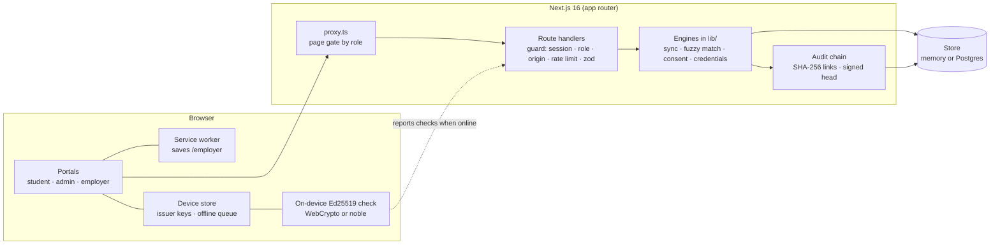

# APAAR Bridge

A privacy-first verification layer between college ERPs, AICTE, NAD/ABC, students and employers. A prototype for SIH 2026 (PS SIH26263).

- **Registrars** turn messy ERP marksheets into clean NAD records, resolve name mismatches before the government check rejects them, and answer student disputes.
- **AICTE** sees compliance per programme, flagged cases with the reasons behind them, and one tamper-evident audit log.
- **Students** get a digital twin (timeline, credit forecast, skill gaps) and a consent wallet where they choose who sees what, and for how long.
- **Employers** verify a credential and get yes-or-no claims the student allowed, with every ID number redacted. Checks work with no network.

Everything here is **sample data**: the people, colleges and ID numbers are fictional.

## Run it

```bash
npm install
npm run dev          # http://localhost:3000
```

Open `/login` and pick a persona. No configuration is needed in development: it uses an in-memory store, a development pepper and an ephemeral signing key. A banner says so in a deployment that is missing real settings.

| Command | What it does |
|---|---|
| `npm run dev` | Development server |
| `npm run build` / `npm start` | Production build and server |
| `npm run typecheck` | TypeScript |
| `npm run lint` | ESLint (flat config, `eslint-config-next`) |
| `npm test` | Vitest: unit tests plus route-level security tests |

## Who can do what

Sign in as one of seven demo personas. The server enforces the role on every route, from a signed cookie. The page gate (`proxy.ts`) is a convenience: a request that skips it still gets a 401 or 403.

| Role | Persona | Can |
|---|---|---|
| Student | Rahul K.V. (adult), Meera S. (age 16) | Own consent wallet, QR creation, disputes, opt-out. Rahul also has the digital twin. |
| Guardian | Sunita S. (Meera's mother) | Co-sign or withdraw consent for Meera. Nothing else. |
| Registrar | Registrar, Vindhya Institute | Marksheet sync, match decisions, dispute inbox, audit log, tokenization. |
| AICTE officer | AICTE officer | National compliance, flagged cases, audit log, incident clocks. No college console. |
| Verifier | Acme Cloud HR, FinServe Bank HR | Verify credentials, ask students for consent, bulk API. Consent is per verifier. |

A person under 18 is determined from the date of birth on the student record. There is no switch a student can flip.

## Architecture



- **Store** (`lib/store`): one small document interface with two implementations. The Postgres one is a single `kv` table; its SQL is tested against real Postgres (PGlite) in `tests/store.test.ts`.
- **Audit chain** (`lib/audit.ts`): consent, match decisions, NAD syncs, grade changes, disputes and offline verifications share one log. Each entry hashes the one before it. The head is signed with the issuer's Ed25519 key, so cutting the log short or recomputing every hash is caught.
- **Matching** (`lib/fuzzyMatcher.ts`): two questions kept apart. *Same person?* (a confidence) and *Will the government check accept it as written?* (literal match). A name can be clearly the same person and still be rejected, so it becomes `AUTO_FIXABLE` with the exact correction.
- **Sync** (`lib/nadSyncEngine.ts`): never invents a grade, credit, course code or prior record. Rows it cannot grade are excluded and reported, and a sync that would leave rows out needs the registrar to confirm.
- **Credentials** (`lib/credentials.ts`, `lib/qrVerify.ts`): Ed25519-signed QR payloads with a key id. Offline verification runs in the browser against cached keys and cannot see revocation, and says so.

## Settings

Copy `.env.example`. In production the first three are required: the app answers `503` naming what is missing (see `/api/health`) instead of falling back to a weak default.

| Variable | Needed | Purpose |
|---|---|---|
| `VAULT_PEPPER` | production | Keys the hash that turns ID numbers into vault tokens |
| `SESSION_SECRET` | production | Signs the session cookie |
| `ISSUER_PRIVATE_KEY_PEM` | production | Ed25519 key for Smart QRs and the audit head (PEM, one line, literal `\n`) |
| `DATABASE_URL` | recommended | Postgres. Without it, state is lost on restart and not shared across serverless instances |
| `DEMO_MODE` | optional | On by default. `false` removes demo personas, the phone simulator and the reset |
| `TOKEN_SALT` | optional | Per-institution salt for vault tokens |
| `ISSUER_KID`, `ISSUER_RETIRED_PUBLIC_KEYS` | optional | Stable key id, and old public keys still trusted after a rotation |

Generate secrets with `openssl rand -hex 32`, and the signing key with `openssl genpkey -algorithm ed25519`.

## Using Postgres

Set `DATABASE_URL`. The table is created on first use (`db/001_init.sql` holds the same statement for manual migration). Sample data seeds itself the first time it is read. The "Reset demo data" button (demo mode, registrar or AICTE) wipes it.

## A five-minute demo

1. **Registrar.** Sign in as the registrar. Load the *sheet with problems* and preview it. Rows with an absent mark and a blank grade are excluded and explained, nothing is graded as an A, and *Sync* stays disabled until you confirm. The student shows *No prior NAD record*.
2. **Mismatch queue.** *Mohd Faraz* vs *Mohammad Faraz* is the same person but would still be rejected, so it is auto-fixable. Open it: the government check would not accept the name, and the exact correction is shown. Apply it with a reason. Reload: the decision is still there.
3. **Student.** Sign in as Rahul. In *Create a QR for an employer*, keep only *Degree status* for 7 days and create it. Download the image.
4. **Employer, online.** Sign in as Acme Cloud HR. Scan from the image: authentic, one claim, ID shown as `[Aadhaar Redacted]`. Try the sample credentials for *revoked*, *superseded* and *expired*.
5. **Employer, offline.** Switch on *Offline verification mode* and, if you like, turn off Wi-Fi. The check runs on the device, says it cannot see revocation, and queues a note to report later. *Simulate tampered QR* is rejected.
6. **Consent.** Request consent as Acme, then approve it as Rahul in his wallet. Acme now sees the claims. Switch Rahul's master switch off: the share shows *Paused* and claims vanish.
7. **A minor.** Sign in as Meera: sharing is refused until her guardian co-signs. Sign in as Sunita, co-sign, and it works. Withdraw it and the share ends.
8. **AICTE.** Sign in as the AICTE officer. The audit log shows every step above under real actors, with a signed head. *Try deleting the last entry* and *Try editing an entry* both fail verification. The spike detector and collision flags show their reasons.

## Known limits

- **Sample and simulated parts.** Marksheet OCR is a button that loads a pre-extracted sheet. The batch retry queue is a browser simulation (no Redis or BullMQ). The phone simulator stands in for the student's own phone and is demo-mode only.
- **Not production-ready.** Demo sign-in has no passwords. API keys are derived from a server secret and cannot be revoked one by one. Rate-limit counters are not pruned automatically. Consent and audit writes are separate store updates, so a crash between them could leave a change without its audit entry.
- **Offline checks cannot see revocation.** A credential revoked after it was issued still looks genuine to a device with no network. A QR a student created expires on its own date, and online it follows the credential it was cut from.
- **Policy numbers are assumptions where labelled.** The 70% lateral-entry overlap has no source. Check the credit thresholds and the credit validity period against current regulation before real use.
- **Translations are drafts.** Fourteen of the 22 scheduled languages have a draft notice. The other eight fall back to English and say so. All need certified legal translation.
- **The camera scanner is untested.** Scanning from an image is tested end to end. The live-camera path could not be exercised headlessly.
